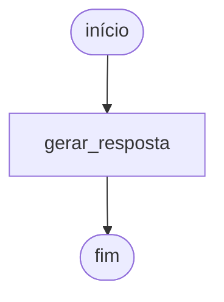

# Suporte Ampère

Chatbot de suporte ao cliente construído passo a passo com **LangGraph**, para estudar na prática os conceitos de engenharia de sistemas de IA: RAG híbrido, memória, guardrails, humano no circuito, observabilidade e evals.

> **Projeto de estudo.** Este repositório é uma reconstrução, feita etapa por etapa, do sistema apresentado na imersão _Arquitetura em Sistemas de IA_ (DascIA). O projeto original, de [Anwar Hermuche](https://github.com/anwarhermuche), está em [anwarhermuche/suporte-ampere](https://github.com/anwarhermuche/suporte-ampere). O código aqui é escrito por mim; as decisões de arquitetura seguem as do original, e as diferenças estão registradas nas notas de cada etapa.

## Estado atual

| Etapa | Conteúdo                                                          | Status |
| ----- | ----------------------------------------------------------------- | ------ |
| 0     | Fundação: config tipada, fábrica de modelos por papel, testes, CI | ✅     |
| 1     | Grafo mínimo com LangGraph (estado e nó gerador)                  | 🚧     |
| 2     | RAG: chunking, embeddings, Qdrant, busca híbrida                  | ⬜     |
| 3     | Roteador de intenção                                              | ⬜     |
| 4     | Agente com Ações (tool calling)                                   | ⬜     |
| 5     | Humano no circuito (aprovação de reembolsos)                      | ⬜     |
| 6     | Guardrails de entrada e saída                                     | ⬜     |
| 7     | Memória de curto e longo prazo                                    | ⬜     |
| 8     | API assíncrona: FastAPI, fila no Postgres, SSE                    | ⬜     |
| 9     | Observabilidade com Langfuse                                      | ⬜     |
| 10    | Evals: Recall@5, MRR, juiz calibrado                              | ⬜     |
| 11    | Frontend                                                          | ⬜     |

Cada etapa fecha com uma tag (`etapa-0`, `etapa-1`, ...), então é possível ver o projeto como ele estava em cada ponto: `git checkout etapa-1`.

## Grafo atual



O diagrama cresce a cada etapa.

## Decisões de design

- **Modelos por papel, não por nome.** O código pede um _gerador_, um _juiz_ ou um _trabalhador_; o `.env` decide qual provedor e modelo atende cada papel. Trocar de provedor não exige mudar código.
- **Fornecedores atrás de interfaces.** Isso permite substituir qualquer serviço externo e usar dublês nos testes.
- **Nenhum teste gasta token.** Os testes rápidos usam modelos falsos. Os que chamam APIs reais ficam atrás do marcador `integration`.
- **Organização por conceito de domínio**, não por camada técnica (`nucleo/`, `grafo/`, `rag/`, ... em vez de `services/`, `controllers/`).
- **Modo demonstração.** Com `MODELOS_FALSOS=true`, o sistema roda sem nenhuma chave de API.

## Stack

Python 3.12 · [uv](https://docs.astral.sh/uv/) · LangGraph / LangChain · Pydantic Settings · Postgres 16 · Qdrant · pytest · ruff · Docker Compose · GitHub Actions

## Como rodar

### Pré-requisitos

Git, [Docker](https://www.docker.com/products/docker-desktop/) (Docker Desktop precisa estar aberto) e [uv](https://docs.astral.sh/uv/getting-started/installation/). O uv instala o Python 3.12 sozinho.

### Instalação

```bash
git clone https://github.com/<seu-usuario>/suporte-ampere.git
cd suporte-ampere
uv sync --project backend
```

### Configuração

```bash
cp .env.example .env        # PowerShell: Copy-Item .env.example .env
```

Para rodar **sem chaves**, deixe `MODELOS_FALSOS=true` no `.env`.

Para usar modelos reais, preencha as chaves e defina `MODELOS_FALSOS=false`:

| Variável         | Onde obter                           |
| ---------------- | ------------------------------------ |
| `OPENAI_API_KEY` | https://platform.openai.com/api-keys |
| `GROQ_API_KEY`   | https://console.groq.com/keys        |

Cada papel tem seu provedor e modelo (`PROVEDOR_GERADOR`, `MODELO_GERADOR`, etc.). Veja o `.env.example`.

> O `.env` nunca é versionado. Rode sempre os comandos a partir da **raiz** do repositório, porque é de lá que ele é lido.

### Infraestrutura

```bash
docker compose up -d
docker compose ps           # Postgres e Qdrant devem estar "healthy"
```

| Serviço  | Porta local |
| -------- | ----------- |
| Postgres | 5439        |
| Qdrant   | 6333        |

As portas são expostas só em `127.0.0.1`.

## Testes e qualidade

```bash
# testes rápidos, sem rede e sem chaves
uv run --project backend pytest backend/tests

# testes de integração (usam chaves reais e gastam token)
uv run --project backend pytest backend/tests -m integration -rs

# lint e formatação
uv run --project backend ruff check backend
uv run --project backend ruff format backend
```

O CI (GitHub Actions) roda lint e testes rápidos a cada push e pull request.

## Estrutura

```
suporte-ampere/
├── .github/workflows/ci.yml
├── docker-compose.yml
├── .env.example
└── backend/
    ├── pyproject.toml
    ├── ampere/
    │   ├── nucleo/        # config, fábrica de modelos, dublês
    │   └── grafo/         # estado, nós e montagem do grafo
    └── tests/
```

## Convenção de commits

O histórico segue [Conventional Commits](https://www.conventionalcommits.org/pt-br/v1.0.0/): `feat`, `fix`, `test`, `docs`, `build`, `ci`, `chore`, `refactor`, com escopos como `nucleo`, `grafo`, `rag`, `infra`.

## Créditos

Arquitetura e domínio do sistema: imersão _Arquitetura em Sistemas de IA_ (DascIA) e o repositório [anwarhermuche/suporte-ampere](https://github.com/anwarhermuche/suporte-ampere). "Ampère" é uma empresa fictícia usada como domínio de exemplo.

## Licença

Defina a licença deste repositório antes de torná-lo público (por exemplo, MIT) e confira a licença do projeto original, caso reutilize trechos dele.
